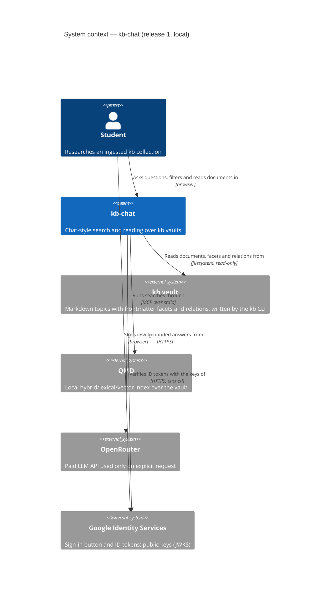
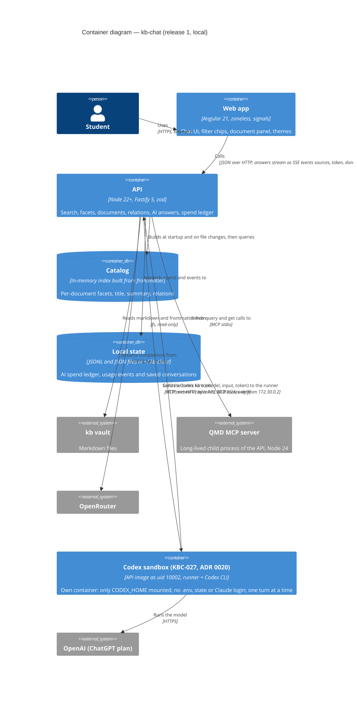

# Architecture overview — kb-chat

Sources: `docs/product/context.md`, `docs/product/vision.md`, `docs/product/brief.md`, `docs/design/screens.md`. ADRs in `docs/adr/`.

## Drivers (QA-01, QA-03)

Ranked, each traced to a business driver from the brief:

1. **Find the right passage fast** (brief: "the most important quality"). Relevance plus latency.
2. **Predictable AI cost** (constraint: OpenRouter credit is limited and already ran out once).
3. **Evolvability to hosted multi-user** (decided: local first, invited users with login in release 2) without a rewrite.

Fixed constraints: Angular frontend; pnpm; the vault is produced and owned by the `kb` CLI (0.0.12, unstable) and indexed by QMD 2.8.3, which needs Node 24 via the `~/.local/bin/qmd` wrapper; code and docs in English, UI in pt-BR.

### Quality attribute scenarios (QA-02, QA-05)

| ID | Quality | Stimulus / environment | Response (measurable) | Importance / difficulty |
|---|---|---|---|---|
| Q1 | Latency, exact | A question in "Palavras exatas" mode, local Mac, warm API | Results rendered p95 ≤ 1 s | H / L |
| Q2 | Latency, semantic and hybrid | A question in "Por significado" or "Tudo" mode, warm API | p95 ≤ 2 s (vec), ≤ 4 s (hybrid); progress shown within 400 ms | **H / H** |
| Q3 | Cost | One "Responder com IA" click | ≤ US$ 0.02 per answer; daily spend never exceeds the configured cap (default US$ 1) | H / M |
| Q4 | Grounding | An AI answer | Every claim cites a retrieved source; with no supporting source it says so | H / M |
| Q5 | Contract stability | A kb or qmd upgrade changes the JSON output | A failing contract test before any user sees broken results | M / L |
| Q6 | Evolvability | Release 2 adds login and hosting | Auth and per-user limits added behind existing ports; search and AI modules unchanged | M / M |
| Q7 | Safety of the vault | Any API request | The API never writes to the vault or the QMD index | H / L |

Spike result to record in ADR 0002 (QA-18): measured on 2026-10-23 while `qmd embed` was running concurrently, so the numbers are pessimistic. Cold `kb search --lex` took 0.68 s; cold `kb search` (hybrid, with query expansion and reranking through local models) took 118 s. Q2 is the riskiest scenario. The walking skeleton measures warm vec and hybrid latency through a long-lived QMD process before any further depth is added.

### ISO 25010 walk (QA-04)

Addressed: performance efficiency (Q1, Q2), functional suitability (Q4), maintainability (Q5, Q6), security (Q7, threat model below), usability (`docs/design/screens.md`). Deprioritised: availability (single local user, restart is fine), scalability (one user in R1). Not applicable in R1: compatibility with other clients, portability beyond macOS.

## Style (SB-01, SB-03)

**One deployable modular monolith**: an Angular SPA served by a Fastify API. Both live in one Nx workspace, sharing zod contracts. The API wraps the vault through **ports and adapters** (SB-13): the core never spawns processes or reads files directly. No microservices (SB-02); there is no driver for independent deployment.

## C4 — System context (AD-01)



Legend: Person = user role; System = this product; System_Ext = existing system outside this repository.

## C4 — Containers (AD-02, AD-03)



Legend: Container = runnable unit or data store in this repository; ContainerDb = data store; System_Ext = outside this repository.

## Modules and dependency rules (SB-04, SB-05, SB-06)

Nx workspace (pnpm):

```
apps/web                 Angular SPA: features/chat, features/document, features/settings, core (http, theme, i18n)
apps/api                 Fastify: modules/*, adapters/*, server.ts (composition root)
libs/contracts           zod schemas + inferred types shared by web and api (the only shared lib)
```

API modules, organised by business capability:

| Module | Owns | Public API |
|---|---|---|
| `topics` | List of topics in the vault | `listTopics()` |
| `catalog` | In-memory facet catalog per topic (facets, title, summary, concepts, relations, duplicate groups) | `getCatalog(topic)`, `facetCounts(ids)` |
| `search` | Search modes, over-fetch and post-filter, duplicate grouping, snippet cleanup | `search(query)` |
| `documents` | Document body without frontmatter, highlight positions, "see also" | `getDocument(topic, id)` |
| `research` | Research agent (ADR 0006): tools over the index, summaries and relations, the tool loop; `find_text` is a paged grep with entity/origin filters, `list_sources`, and the exhaustive profile with compaction (ADR 0013), planned with `plan_sweep` and swept in batches by the app with coverage it measures (`sweep/`, ADR 0021; replaces ADR 0014's `delegate`) | `ToolLoopRunner.run(turn)` (stream), `ResearchTools` |
| `spend` | Spend ledger, daily cap and credit checks (ADR 0004) | `SpendService.guard(usd)`, `record(turn)`, `today()` |
| `usage` | Local event log for the research plan | `record(event)` |
| `conversations` | The complete conversation history (search and research), no cap, keyed by principal; research turns recorded by the server as they start and end (KBC-029), merged by turn id with the page's snapshots, and a pending turn that no longer runs read as interrupted | `list(principal, filter)`, `get(principal, id)`, `save(principal, conversation)`, `beginTurn`, `finishTurn`, `remove(principal, id)` |
| `auth` | Google sign-in, one-time code sign-in, sessions, people and their permissions (ADR 0008, ADR 0011) | `PeopleService`, `SessionService`, `OneTimeCodes`, `SendLimits`, `RequestTickets`, `Notifier`, `authRoutes`, `codeRoutes`, `peopleRoutes`, `principalOf(request)`, `RouteAccess` |
| `house-ai` | The app's own AI (KBC-022, ADR 0016): the house OpenRouter account (OAuth PKCE or pasted key, sealed), the live free-model list, the per-person daily quota, key provisioning per person, and the turns of the owner's lent subscription (KBC-024, ADR 0019: `HouseResearchRunner` with `plan: app-subscription` over `SubscriptionLedgerRunner`); the AI access policy lives on the person record (`auth`) | `HouseAiService`, `FreeModelCatalog`, `HouseQuota`, `OpenRouterConnect`, `houseAiRoutes` |
| `media-corrections` | Word corrections of a recording's current transcript (KBC-093, ADR 0034): one word or up to 5 of a segment, "Corrigir todas" as a group of up to 200, undo (single and group), the append-only log, and the carry-over to a new version by time and text; written in place with a revision, in one transaction with the search index, the published tracks that hold the word and their documents (KBC-100). Port `TranscriptCorrectionStorePort` → `SqliteTranscriptCorrectionStore` (`media.db`, migration 29) | `TranscriptCorrectionService`, `correctionRoutes` |
| `access-levels` | Access levels per collection (KBC-103, ADR 0036): the scales (`access-levels.json`) and document levels (`document-levels.json`) in the state folder, the rule of §6, the first scale's bulk placement, and the audit `audit/levels-YYYY-MM.jsonl`; every content route asks `ContentGate.viewFor(person, topic)` for a `LevelView` (search, facets, suggestions, topic counts, documents and relations). AI research (KBC-104) carries the turn's view in `ResearchInput.view`: every tool (`isVisible`), the exhaustive sweep's set (`LevelView.entries(scope)`) and the turn's MCP tools for the lent Claude and Codex (`ResearchToolsFactory(topic, view, tracks)`). `LevelView` is a port (`ports/level-view.ts`) so the research ports can carry it. Media follows its level (KBC-105), each track its own (KBC-106: `media.level_own`, hidden parts of a recording masked in the stream and left out of its text and search) | `ContentGate`, `LevelView`, `AccessLevelsService`, `LevelDirectory`, `accessLevelRoutes`, `levelViewOf(request, topic)` |
| `access-requests` | Asking for access (form or Google) and the masters' decisions (KBC-014, ADR 0011); depends on `auth` through its barrel | `AccessRequestService`, `SignUpFlow`, `accessRequestRoutes` |

Ports (interfaces in the module) and their adapters (in `adapters/`):

- `SearchIndexPort` → `QmdMcpAdapter`, the primary adapter (a long-lived `qmd mcp` child; ADR 0002), and `KbCliSearchAdapter`, the fallback (`kb search --format json` via `execFile`, no shell).
- `VaultReaderPort` → `FsVaultAdapter` (read-only, path-confined to the vault root).
- `LlmPort` → `OpenRouterAdapter` (with a `models` fallback chain in windows of 3, KBC-022), `AnthropicAdapter`, `OpenAiAdapter`; the house plan wraps OpenRouter in `HouseLlm` (`providers/`).
- `SecretSealerPort` → `SecretBox` (AES-256-GCM, `KB_CHAT_SECRETS_KEY`); `SealedSettingsStore` seals every key of `settings/<principal>.json` (ADR 0016).
- `OpenRouterAccountPort` → `OpenRouterAccountClient` (models, `GET /key`, OAuth code exchange, management keys); `HouseUsagePort` → `JsonlHouseUsage` (`house-usage.jsonl`); the house's paid spend is a second `JsonlSpendLedger` (`house-spend.jsonl`).
- `LedgerPort` → `JsonlLedgerAdapter`.
- `IdentityVerifierPort` → `GoogleIdTokenVerifier` (JWKS cached per Cache-Control; the E2E server uses its own test keys).
- `PeopleStorePort` → `JsonPeopleStore` (`people.json`, 0600); `SessionStorePort` → `FsSessionStore` (`sessions/<sha256>.json`, 0600).
- `DocumentStorePort` → `JsonDocumentStore` (`codes.json`, `access-requests.json`, 0600, atomic); `EmailSenderPort` → `SmtpEmailSender` (production, Gmail SMTP with an app password, ADR 0012) or `ResendEmailSender` (production with a verified domain), `LogEmailSender` (development), `MemoryOutbox` (tests, E2E); `SmsSenderPort` → `LogSmsSender` (development only; no production provider yet, ADR 0011).
- The access guard (`plugins/auth-guard.ts`) reads each route's `config.access`; `plugins/route-access.ts` refuses an `/api/v1` route without one (ADR 0008, replacing ADR 0005's seam).

Dependency rules, enforced by `eslint-plugin-boundaries` or Nx module-boundary tags in CI (SB-06, QA-15):

- `apps/web` may import only `libs/contracts`.
- `apps/api` modules import other modules only through their `index.ts`.
- Modules never import from `adapters/`; only `server.ts` wires them.
- `libs/contracts` imports nothing from the apps.

## Data ownership

- **The vault is owned by kb.** kb-chat is read-only (Q7). The catalog is a derived, rebuildable cache, never a second source of truth.
- **Frontmatter keys read:** `title`, `summary`, `genre`, `depth`, `relevance`, `concepts`, `example_of`, `extends`, `related`, `type`, `stage`, `ingest_batch`. A missing key means the facet value "(none)" and is hidden in the UI.
- **Duplicate groups** (same normalized title, e.g. `a-natureza-s-tupla-2.md` and `-5.md`) are computed in the catalog, and search returns the best-scoring member with `duplicates: n`.
- **Spend ledger and usage events:** owned by `spend` and `usage`, stored under `~/.kb-chat/`, with 90-day retention for events (research plan).
- **People and sessions:** owned by `auth`: `~/.kb-chat/people.json` and `~/.kb-chat/sessions/` (0600). Every per-person store is keyed by principal: the Google `sub`, except the owner, who keeps the `owner` alias of the data written before logins.
- **Access requests and one-time codes:** owned by `access-requests` and `auth`: `~/.kb-chat/access-requests.json` (pending and recently refused requests, with name, email and phone) and `~/.kb-chat/codes.json` (salted scrypt hashes only, 10 min), both 0600 (ADR 0011).
- **Conversations:** owned by `conversations`, one JSON file per conversation in `~/.kb-chat/conversations/<uuid>.json` (mode 0600, written to a temp file and renamed), kept forever; unreadable files are skipped with a warning.
- **Recorded research turns (KBC-029):** a turn sent with `conversationId` and `turnId` is written as `status: pending` before the agent starts and replaced by its outcome when it ends (answered, `interrupted`, or `status: failed` with `error`). It runs apart from its request (`LiveTurns`, in memory, one per conversation, 60-minute ceiling): a reload or a closed tab does not stop it; only "Parar" (`POST /research/turns/{id}/stop`) or the ceiling does, and a page can follow it again from its first event. A pending turn not running in this process, from before its start or idle past a 2-minute grace, or older than the ceiling, is read as interrupted (never written on read). The page's `PUT` merges turns by id: a pending snapshot never overwrites an ended turn, and turns the server recorded stay. The fields are optional, so older files load unchanged.

## Contracts (CS-01, CS-08, CS-09, CS-11)

HTTP JSON API under `/api/v1` (versioned by path). The zod schemas in `libs/contracts` are the contract; Fastify is typed from them through `fastify-type-provider-zod`, and an OpenAPI document is generated from the same schemas.

| Method and path | Purpose |
|---|---|
| `GET /api/v1/topics` | Topics with document counts |
| `GET /api/v1/topics/{topic}/facets` | Facet values with collection-wide counts |
| `POST /api/v1/topics/{topic}/searches` | Body `{ q, mode: all\|exact\|semantic, filters, cursor? }` → `{ items[], facets (counts over the result set), total, nextCursor, tookMs }`; POST because the filters are structured, with no side effect beyond the usage event |
| `GET /api/v1/topics/{topic}/documents/{id}` | Body markdown without frontmatter, facets, summary, see-also groups, highlight terms |
| `POST /api/v1/topics/{topic}/research` | One research turn for `{ question, history, profile, conversationId?, turnId?, sweep? }`: streams (SSE) `step`, `sources`, `token` (with its `segment`), `retract`, `sweep` (exhaustive: estimate and progress), `done` (cost, steps; exhaustive: `coverage` and the cursor `sweep`) or `error` (ADR 0006, ADR 0009, ADR 0021); `sweep` in the body continues an unfinished sweep; rate-limited (`RESEARCH_RATE_LIMIT`), the daily cap checked before every model call. With both ids the turn is recorded in that conversation and runs on when the request goes away (KBC-029); without them it stops on disconnect, as before |
| `GET /api/v1/research/turns/{turnId}/events` | The person's running turn from its first event, then live (SSE); 404 when it does not run (KBC-029) |
| `POST /api/v1/research/turns/{turnId}/stop` | "Parar": stops the person's running turn, which is recorded as interrupted (204, idempotent) |
| `GET /api/v1/spend/today` | Spend today and the cap |
| `GET /api/v1/spend/people` | Owner only: each person's spend today (BR-6) |
| `GET /api/v1/conversations` | Every saved conversation as summaries, newest first by `updatedAt`; optional `?kind=search\|research&topic=` |
| `GET` / `PUT` / `DELETE /api/v1/conversations/{id}` | One conversation (uuid id): read, upsert (path id must equal body id; answers with the summary), remove (204, idempotent) |
| `GET /api/v1/auth/config` | Public: the Google client id for the sign-in button |
| `POST /api/v1/auth/google` | Public, rate-limited: `{ credential }` (Google ID token) → the person (`Me`) and the session cookie; 403 `NOT_INVITED` |
| `POST /api/v1/auth/logout` | Ends the session (204) |
| `POST /api/v1/auth/code`, `POST /api/v1/auth/code/verify` | Public, limited: a one-time code by email or SMS (always 202) and its exchange for the session (400 `INVALID_CODE`) (ADR 0011) |
| `POST /api/v1/access-requests/signup`, `.../signup/verify`, `.../google` | Public, limited: ask for access with the form (email code first) or with the ticket of a not-invited Google sign-in |
| `GET /api/v1/access-requests`, `POST .../{id}/approve`, `POST .../{id}/refuse` | Masters only: pending requests, approve (the person with the invite defaults), refuse (24 h before asking again) |
| `GET /api/v1/me` | Who is signed in: email, name, picture, role, features, visible collections, `isOwner` |
| `GET` / `POST /api/v1/people`, `PATCH` / `DELETE /api/v1/people/{id}` | Masters only: list, invite, change collections, features and role, revoke (409 `LAST_MASTER`, `OWNER_PROTECTED`, `ALREADY_INVITED`) |
| `GET /health` | Readiness: catalog loaded, QMD alive, LLM configured |

- **Errors:** one shape, `{ error: { code, message, details? } }`. Stable codes: `TOPIC_NOT_FOUND`, `INDEX_MISSING`, `SEARCH_UNAVAILABLE`, `DOCUMENT_NOT_FOUND`, `LLM_NOT_CONFIGURED`, `LLM_INSUFFICIENT_CREDIT`, `DAILY_CAP_REACHED`, `VALIDATION_FAILED`, and for sign-in and permissions `UNAUTHENTICATED` (401), `FORBIDDEN`, `NOT_INVITED`, `CSRF_REJECTED` (403), `LAST_MASTER`, `OWNER_PROTECTED`, `ALREADY_INVITED` (409), `AUTH_UNAVAILABLE` (503), and for access requests `INVALID_CODE`, `REQUEST_EXPIRED` (400), `ALREADY_REQUESTED` (409), `REQUEST_COOLDOWN` (429).
- **Access:** every `/api/v1` route except sign-in needs a session; collection routes answer 404 for a collection the person cannot see, feature and people routes 403 (ADR 0008). No stack traces (CS-08). The web maps each code to the pt-BR copy in `screens.md`.
- **Pagination:** opaque cursor, default 10, max 50 (CS-09).
- **Filters:** filter fields are allowlisted to the facets above (CS-10).
- **Document ids:** the vault-relative path, URL-encoded. The API rejects any id that resolves outside the topic folder.

## Threat model (CS-17), local R1

1. **What are we building?** A local API that reads a folder, spawns QMD and calls a paid API.
2. **What can go wrong?**
   - Path traversal through a document id, reading `~/.ssh`.
   - Another site in the browser calls `localhost` and spends AI credit (CSRF/DNS rebinding).
   - The OpenRouter key leaks in logs or to the client.
   - Prompt injection inside a vault document steers the AI answer.
   - Command injection through the query into a spawned process.
3. **What are we doing about it?**
   - Path confinement with `realpath` checks.
   - Bind to `127.0.0.1`, strict CORS to the web origin, `Host` header allowlist, the daily cap checked before every model call of the research agent (CS-19).
   - The key is read only from env, redacted in logs, and never in a response (CS-22).
   - The system prompt treats sources as quoted data; answers render as sanitized markdown, with no HTML or links other than citations.
   - `execFile` with an argument array, never a shell, and the query passed as a single argument.
4. **Did we do a good job?** Tests for traversal ids, the Host and CORS rejection and the cap. Revisit before R2 (auth, hosting).

### Sign-in and permissions (KBC-010, ADR 0008)

1. **What are we building?** Google sign-in for several people, with server sessions and per-person collections and features.
2. **What can go wrong?**
   - A forged or replayed ID token, or one minted for another app (wrong `aud`), opens a session.
   - Another site makes a signed-in browser change state (CSRF) or signs it in as the attacker (login CSRF).
   - A stolen session cookie or a copy of the sessions folder.
   - A guest reaches a collection, a feature, another person's history or keys, or the owner's subscriptions and environment keys.
   - A revoked person keeps working; the last master is removed and nobody can manage access.
   - Brute force on the sign-in route; tokens or emails in the logs.
3. **What are we doing about it?**
   - RS256 signature against Google's JWKS, `aud`, `iss`, `exp`/`iat` (60 s skew, 1 h max age) and `email_verified`; the issuer and keys URL are constants. Each credential opens one session (a replay is refused while it is valid); the keys download times out after 5 s.
   - `SameSite=Lax` plus the `X-Requested-With: kb-chat` header and the `Origin` check on every state change, sign-in included.
   - `HttpOnly` cookie (`Secure` when hosted); only the token's SHA-256 is stored, in 0600 files; sliding 30-day expiry.
   - One guard driven by `config.access` on every route (404 for unseen collections, 403 for features and roles), conversations and settings keyed by principal (saving over another person's id answers 404), subscriptions and environment keys for the owner only, except the Claude subscription the owner lends person by person (KBC-024, ADR 0019); the owner sees spend per person, not content.
   - Codex (ADR 0020): never in the API container; each turn runs in the `codex` service (the API image as uid 10002, only `/srv/kb-chat/codex` mounted, no `.env`, state, Claude login or secrets key, read-only root, no capabilities), one at a time, through a runner that builds the locked-down arguments itself and answers only the API's address. From the Codex address the API answers only the MCP routes (every other route is 404, so sign-in, codes and the proxy's forwarded-for trust are out of reach), and those by the turn's token; the cloud's metadata service is dropped for the `codex` subnet. CI proves on every PR, on arm64, that a turn there finds no canary of the state, the Claude login, the deploy `.env` or the secrets key, no extra mount, no capability and no metadata service. Accepted: Codex can read its own login and reaches the internet.
   - Lent subscription (ADR 0019): only the owner grants it (403 to other masters, the terms confirmed in the request); a guest's question then runs on the owner's Claude Code with no built-in tools (`--tools ''`, only the kb MCP tools of a per-turn token, `--strict-mcp-config`, `--setting-sources ''`), on a topic the research route already checked for that guest, so an injected prompt reaches only that collection's kb tools; the guest spends the owner's usage limits, bounded by the guest's daily quota.
   - Revocation deletes the sessions at once; `LAST_MASTER` and `OWNER_PROTECTED` keep a master in place.
   - `config.rateLimit` on sign-in; the log carries the person id, never the token or the email.
4. **Did we do a good job?** Tests: token verification with a local key and a fake JWKS (no network), the guard matrix per route kind, the route-coverage check (NFR-2), revocation, the last master, CSRF and the owner migration (`auth.integration.test.ts`, `route-access.test.ts`); E2E AC-1 to AC-7 at 1440 and 390.

### Access requests and one-time codes (KBC-014, ADR 0011)

1. **What are we building?** Public routes that send codes by email (SMS later), create access requests and open sessions with a code.
2. **What can go wrong?** Account enumeration through answers or timing; guessing a 6-digit code; email or SMS bombing through the send routes; a copy of `codes.json` giving codes back; reusing a Google credential or forging the request ticket; a pending, refused or revoked person getting a session; codes in production logs.
3. **What are we doing about it?** Same 202 body for every account state and delivery after the reply; 5 attempts per code, 10 min, single use, a new code replaces the old; 1/min and 5/h per email or phone, 5/min and 20/h per address, verify routes rate-limited; scrypt with a salt per code and `timingSafeEqual`; HMAC-signed, 15 min, single-use tickets with a boot-time key; sessions only for people in `people.json`, checked again at verify time; the API refuses to start in production without a complete email provider (Gmail SMTP pair or Resend) or with the SMS log adapter, and with half of the SMTP pair in any environment; SMTP errors carry only the nodemailer and reply codes, never the app password or the body.
4. **Did we do a good job?** Tests: `one-time-codes.test.ts`, `send-limits.test.ts`, `request-ticket.test.ts`, `request-rules.test.ts`, `access-requests.integration.test.ts` (enumeration, approval gate, revocation after send, cooldown, permissions), `route-access.test.ts`; E2E `access.spec.ts` at 1440 and 390.

### Access levels (KBC-103 to KBC-111, ADR 0036)

1. **What are we building?** Ordered levels per top-level collection (QS < CI < CDC …), one per person and one per item (vault document, audio, track, track document), held in the app's state and `media.db`; every content surface reads through the person's `LevelView` (`ContentGate.viewFor`), masters see everything.
2. **What can go wrong?**
   - A surface reads the catalog or the media lists directly and names a hidden item (title, id, snippet, author, passage, citation), or counts it (totals, facets, copies, "Veja também", "Ver todas (N)", coverage, tracks of a recording).
   - A single item route answers 403 (or a different 404) and so confirms a hidden item exists.
   - Stored or client-sent content outlives a level change: a saved answer's sources, a sweep cursor's findings, bookmarks, recents and progress, a follow-up's cited ids.
   - The research model (and the lent Claude or Codex behind the MCP token) gets a hidden text in a tool output and repeats it.
   - A track above its recording leaks through the recording: the audio bytes, the transcript, subtitles, words, "Na fala", the edit and correction routes, the subjects of the track.
   - An editor below a track lowers it by saving the draft; an import from the Mac creates a track below its recording.
   - A new route or a new reader of the catalog skips the view.
3. **What are we doing about it?**
   - One rule, `allows(viewer, item)` (ADR 0036 §6), and one place that builds views (`ContentGate`); set surfaces filter before they compute, SQL surfaces filter in the query, the QMD ranking is filtered where hits become entries, with the adaptive budget (§7).
   - Hidden single items answer 404 exactly like missing ones (`DOCUMENT_NOT_FOUND`, `MEDIA_NOT_FOUND`); stored answers and cursors are re-checked at read (§8, KBC-110); bookmarks, recents and progress of an item the person no longer sees are left out.
   - The research tools are built per turn with the turn's view, the MCP token maps to those tools (§7).
   - Tracks answer by their own level everywhere; a hidden part of a recording is masked as silent AAC frames, a restricted transcript item and no words or subtitles (KBC-106); whoever does not hear every track of a recording gets 403 `EDIT_ABOVE_YOUR_LEVEL` on every edit and correction route; imports keep a track at least at its recording's level.
   - Accepted signals, decided by the owner: the duplicate answer `duplicate-hidden` to whoever sends an identical file (KBC-105 FR-5), and a hidden part's bounds and place among its recording's tracks ("Trecho restrito", "faixa 3 de 3"; KBC-106 FR-2). Residual: a speech hit's BM25 score is computed over the whole FTS5 table, so its value (never its order) moves with the hidden corpus.
4. **Did we do a good job?** Executable, in CI on every API change (`tools/ci/select-jobs.test.mjs` holds every API path to the API tests):
   - `levels-leakage.integration.test.ts` (KBC-111): every `/api/v1` route read from `app.routeAccess`, with every candidate id (hidden and open), as Ana (CI, every member feature) and as the master, plus the research SSE stream and what the model was told; no mark of a CDC item reaches Ana, every mark reaches the master, every read route answers someone (or declares why not), a route added without the view is caught by name, and Ana's counts equal those of a twin collection without the hidden items.
   - `levels-boundary.test.ts` (KBC-111): TypeScript's checker finds every call of `CatalogRegistry.get/scope/scopeView/topics` and of the media store's lists (`listMedia`, `listLibrary`, `findBySource`, `findEverywhere`) outside `catalog`, `access-levels` and the composition root; the readers that remain are pinned per file and method with the reason they are safe.
   - `open-view-boundary.test.ts` (only the gate builds a view), the per-surface suites (`search-levels`, `research-levels`, `research-levels-tracks`, `sweep-levels`, `media-levels`, `track-levels*`, `conversations-levels`, `track-subjects-levels`) and the recall and latency script `src/scripts/levels-recall.ts` (report in `work/KBC-111/recall.md`: the budget is right, but QMD 2.8.3 returns at most 20 hits per sub-search, so a member who sees a small share gets short pages; KBC-120).
   - Features not built yet (playlists, sharing, Favoritas, the queue, offline with the revoke reason `level`, KBC-052 to KBC-058) inherit the rule: their routes enter the leakage suite by themselves, and their lists read the library through the view.

## Phase 2: media library (planned, KBC-034 to KBC-040)

- Module `preparation` (KBC-072): the guided flow's plan per recording; it asks the transcription, the separation and the proposals for each stage in turn and reads their state from them, keeping only what they cannot say. A paid stage starts once, from the person's stored choice, and only reserves then. A run that failed or was cut by a restart keeps its finished windows; only a click goes on, paying for the windows missing.
- New module `media`: owns `/data/media/media.db` (SQLite with WAL and FTS5), the media files, the job queue (leases, heartbeats, janitor, dead jobs), the transcript versions and the term list (ADR 0022). The vault stays read-only (Q7): transcripts are indexed in the app's own FTS5 and merged into search results (ADR 0024).
- New container `media-worker` (API image, 1 CPU, 2 GB, ffmpeg): transcodes, silence detection and later cuts and compilations; it leases jobs over HTTP with a worker token like any remote worker (ADR 0022).
- Transcription runs outside the VM, in a pull worker on the owner's Mac (`tools/transcriber/`, Python with uv, mlx-whisper turbo with VAD and terms), with Groq as an opt-in fallback under a monthly cap (ADR 0023). The raw JSON is the source of truth; segments, words, filter and confidence are derived in the API.
- `PATCH /api/v1/media/{id}` (KBC-050) changes title, author and collection for who sent it (while they have `media-upload`) and masters: 404 without access, 403 without the right, 404 `TOPIC_NOT_FOUND` for a destination the person does not see. Positions, bookmarks and transcripts follow the id; a move to another top-level collection refuses an author that list does not have, and carries the labelled speakers to the new list in the same transaction as the move.
- Uploads (KBC-035, ADR 0033): `POST /api/v1/topics/{topic}/media/check` answers what a file is before anything is sent (new, duplicate, resume, expired, over-quota); `HEAD` and `PATCH /api/v1/media/{id}/upload` are the tus 1.0 core on the item. Quota per person: 5 GB of converted space by default, editable by masters, none for the owner.
- `GET /api/v1/media/{id}/transcript/words?from=&count=` (KBC-045) serves the words of up to 200 segments through the index `words_by_segment_position`, with the transcript's access. It is apart from `…/transcript` so that reading a transcript never scans its words; the panel asks for 100 segments at a time, when it needs them.
- New routes (planned): `/api/v1/topics/{topic}/media`, `/api/v1/media/{id}/stream|subtitles.vtt|transcript`, `/api/v1/media/terms` (masters, KBC-040: `GET`, `PUT`, `POST …/measure`), `/api/v1/media-worker/*` (worker token only); the search response gains an additive `media` field.

## Operability (CS-21 to CS-25)

- **Config by env:** one email provider with `NODE_ENV=production`: `SMTP_USER` + `SMTP_PASSWORD` (Gmail, `SMTP_HOST`/`SMTP_PORT` default `smtp.gmail.com`/465) or `RESEND_API_KEY` + `KB_CHAT_EMAIL_FROM` (ADR 0012), `KB_CHAT_SMS` (`off` | `log`), `GOOGLE_CLIENT_ID` and `KB_CHAT_OWNER_EMAIL` (required; read from the repository root `.env` by `pnpm dev:api`), `AUTH_RATE_LIMIT`, `KB_VAULT` (default `~/dev/personal/hermetismo`), `QMD_BIN`, `KB_BIN`, `OPENROUTER_API_KEY`, `KB_CHAT_MODEL` (default: the vault's `kb.toml` generation model), `KB_CHAT_DAILY_CAP_USD` (default 1), `PORT`, `WEB_ORIGIN`.
- **Hosting (ADR 0010):** production runs as a Docker Compose project on one OCI Always Free VM, Caddy in front. The container sets `HOST=0.0.0.0` and `TRUST_PROXY=uniquelocal`; the MCP turn endpoint refuses non-loopback sockets. Deployment diagram, threat model and runbook: ADR 0010 and `docs/deploy/runbook.md`.
- **Logs:** structured pino to stdout with a correlation id, route, status and latency.
- **Health:** `/health` reports catalog, QMD and LLM status, which the web uses for the "server is down" states.
- **Lifecycle:** on SIGTERM, close QMD and drain streams. QMD restarts with backoff when it dies.
- **Sensitivity point to monitor (QA-08):** search latency p95 per mode, logged per request and summarised in `usage`.

## Fitness functions (QA-14) → backlog

- **Boundaries lint** fails CI on a cross-module or adapter import (QA-15).
- **Access levels** (ADR 0036 §12, KBC-111): the leakage suite over every `/api/v1` route and research event, and the type-aware boundary test on the catalog and media list readers.
- **Contract test** runs kb and QMD JSON fixtures through the adapters (Q5), plus a live smoke against the real vault behind `KB_VAULT`.
- **Latency check** in the skeleton: a script measures p95 for 20 real queries per mode and fails above the thresholds of Q1 and Q2. It starts as a dated warning (QA-16).
- **Path traversal and Host or CORS tests** (threat model).
- **Contrast check** for the three theme token sets (design).
